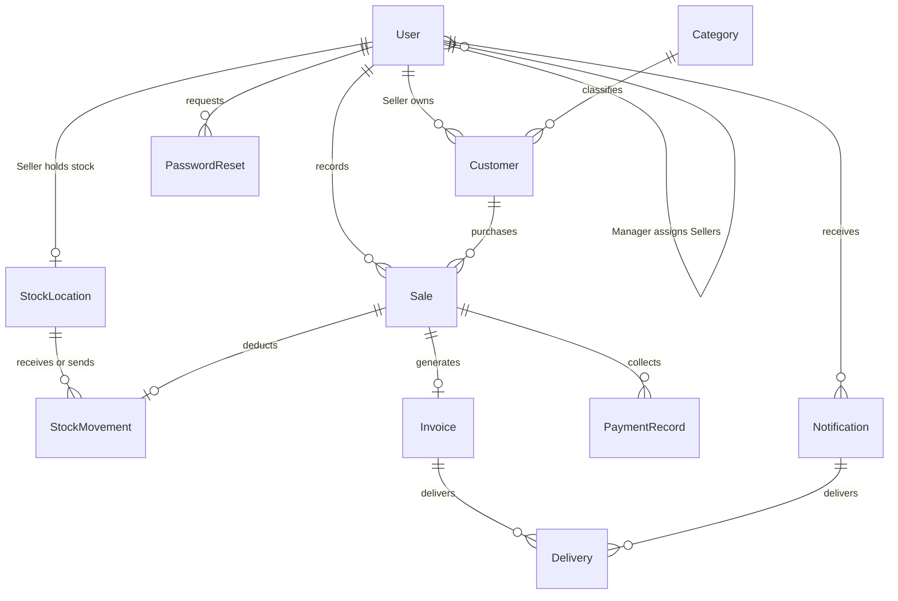

# Database design

The schema is implemented in prisma/schema.prisma; the initial migration creates the tables. Having a table does not mean every corresponding business API is implemented. Current APIs cover authentication and Manager/Seller management.

## Important decisions

- One User table contains SUPER_ADMIN, MANAGER and SELLER accounts. A Seller refers to one Manager through managerId; non-Sellers have no managerId. Role of the referenced Manager is also checked by the service.
- Email is lowercase and unique when supplied. Phone uses international +country-code format and is unique when supplied. API-created Managers/Sellers require phone; the initial Admin can use email only.
- Passwords are bcrypt hashes, never plaintext. tokenVersion lets password change/deactivation invalidate already-issued JWTs. Permissions are a small validated list on a Manager.
- Categories are configurable. Customers belong to a Seller and record who created them. Geography is text; GPS uses fixed-precision decimals.
- Each Seller has one stock account. A partial unique index permits only one HQ. Warehouses are additional StockLocation rows. StockMovement is the proposed permanent movement history, rather than just a mutable total.
- Quantities and balances are whole packets. The database rejects negative balances and nonpositive movement/sale quantities. Money is integer paise; ₹25 is 2500. Sale total must equal quantity times unit price.
- Pending/rejected sales will not get a sale movement, invoice or earned incentive. These workflows remain to be implemented. Sale fields hold one approval decision and confirmed incentive snapshots.
- BusinessSettings is a singleton. Its incentive rate is null until explicitly configured; the PRD example ₹15 is not a default.
- One invoice per sale is enforced with a unique key. The JSON snapshot will preserve customer/sale details as they were at confirmation.
- Payment records hold actual collected Cash/Bank amounts, never Pending. Delivery records reference exactly one invoice or notification.
- PasswordReset stores a hashed reset token, expiry and use time. Password recovery endpoints/delivery are not implemented yet.
- Dates are stored as Prisma DateTime. API date formatting will use ISO 8601 UTC; business month boundaries will use Asia/Kolkata.

## Access and transactions

Express checks JWT, current account, role, permissions and assignment/territory. Manager queries combine this scope with requested filters using AND. Requests cannot replace scope by passing another managerId. Outside-scope records return 404.

Seller creation and its zero-balance StockLocation run inside one serializable transaction. If either fails, neither record is saved. Manager territory changes are rejected when existing Sellers would fall outside it. Seller reassignment is not implemented in this increment.

Supabase table RLS is enabled without public policies. A server-only PostgreSQL owner connection runs the backend queries; Supabase browser anon clients cannot bypass Express authorization. These application JWTs are not Supabase Auth tokens.

## Migration and validation status

Prisma schema validation and client generation can run without connecting to a database. SQL checks live in the migration because Prisma schema syntax cannot express all of them. Use checked-in migrations, not db push, to preserve those checks.

Apply with npm run db:migrate against the intended development database. Then bootstrap with npm run db:bootstrap-admin. Actual migration application and database integration must be verified in that environment; see the README for the isolated integration suite.
