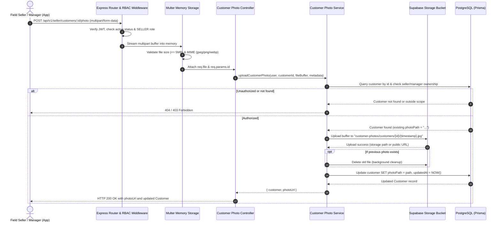
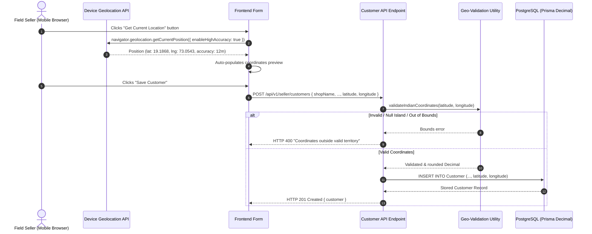
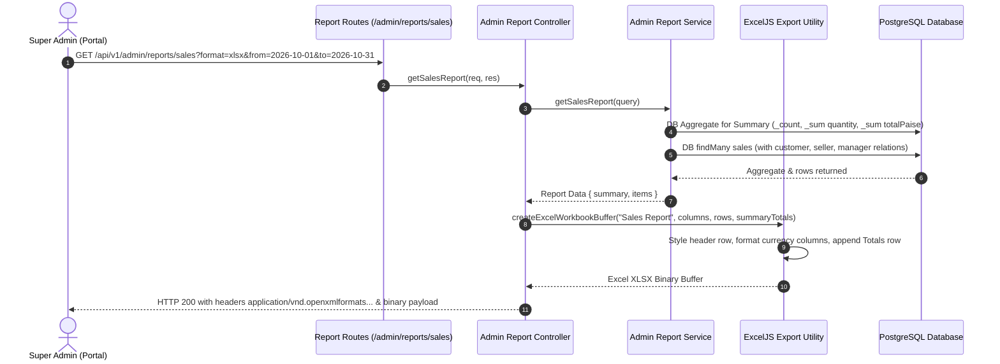
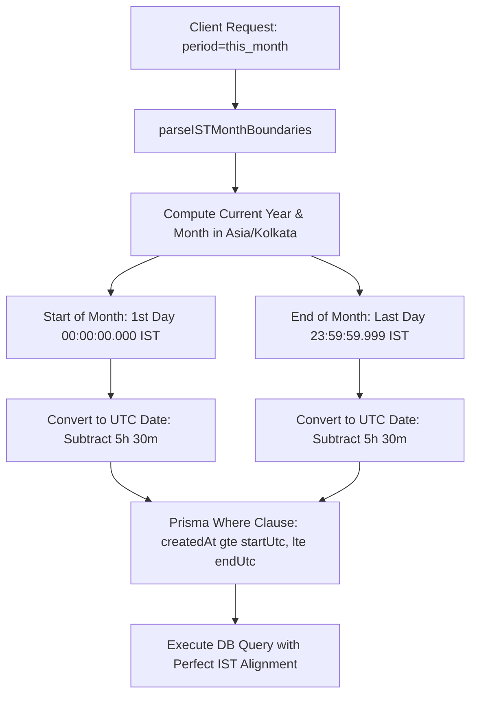
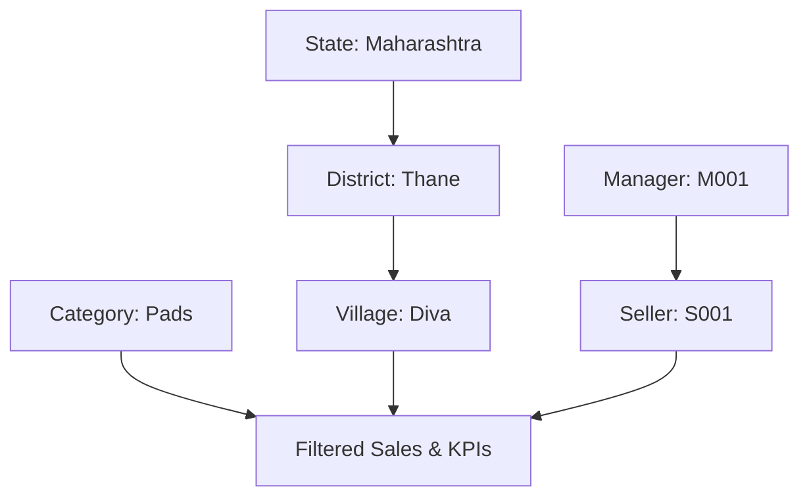
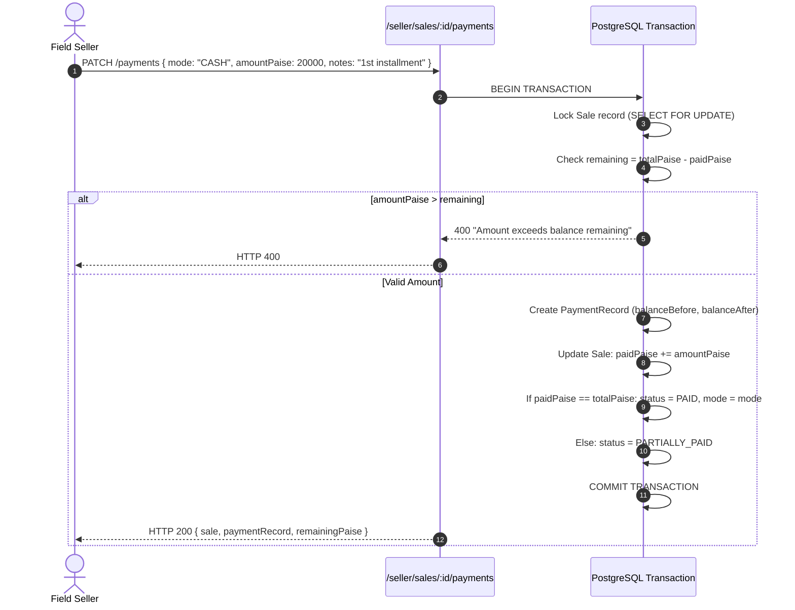
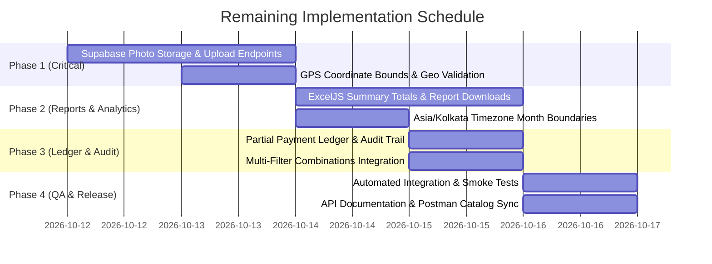

# Comprehensive Remaining Implementation Plan: FemmeFlo YFA Inventory Platform

**Document Version:** 1.0.0  
**Target Architecture:** Node.js (v22+) • Express 5 • TypeScript • Prisma 7 • PostgreSQL (Supabase)  
**Related Documents:** [PRD.md](file:///c:/Users/Hitesh/Desktop/Inventory-Project/femmeflo-yfa-inventory-server/docs/PRD.md) • [API.md](file:///c:/Users/Hitesh/Desktop/Inventory-Project/femmeflo-yfa-inventory-server/docs/API.md) • [IMPLEMENTATION.md](file:///c:/Users/Hitesh/Desktop/Inventory-Project/femmeflo-yfa-inventory-server/docs/IMPLEMENTATION.md) • [DATABASE.md](file:///c:/Users/Hitesh/Desktop/Inventory-Project/femmeflo-yfa-inventory-server/docs/DATABASE.md)

---

## 1. Executive Summary & Coverage Status

Following the Backend API Coverage Analysis, **18 of 28 PRD modules (78%) are fully implemented and verified**, operating with strong RBAC, token versioning, territory scoping, and atomic database transactions.

This plan details the implementation strategy for the **6 remaining high-impact features** required to reach 100% MVP readiness (excluding external WhatsApp/Email communication provider setup):

| # | Feature / Module | PRD Section | Priority | Est. Effort | Impact |
|---|---|---|---|---|---|
| 1 | **Photo Upload to Supabase Storage** | Section 5.1 & 19 | 🔴 Critical | 2 Days | Unblocks mobile Customer Onboarding with storefront imagery |
| 2 | **GPS Location Capture & Validation** | Section 5.1 & 19 | 🟠 High | 1 Day | Ensures geo-coordinates integrity, bounding box, & distance audit |
| 3 | **Reports & Analytics (CSV/XLSX Export)** | Section 1, 2.1, 23 | 🟠 High | 2 Days | Provides executive Excel/CSV downloads with formatted sums and totals |
| 4 | **Timezone Accuracy (Asia/Kolkata)** | Section 16 & 21 | 🟡 Medium | 0.5 Day | Eliminates UTC month boundary drift (00:00 - 05:30 IST) in sales filters |
| 5 | **Multi-Filter Combinations & Drill-Down** | Section 22 | 🟡 Medium | 1.5 Days | Enables 6-dimensional AND filtering (State → District → Village → Manager → Seller → Category) |
| 6 | **Payment Collection Flow & Audit Trail** | Section 14 | 🟡 Medium | 1 Day | Enables partial collections, installment tracking, and immutable audit logs |

---

## 2. Feature 1: Photo Upload to Supabase Storage

### 2.1 Context & Business Requirement
Under PRD Section 5.1 and 19, field Sellers and regional Managers onboard customers by capturing shopkeeper details, category, location, and a **storefront/shop photo**. The mobile or web app captures the photo from the camera or file picker and uploads it. The backend must:
1. Accept multipart form data uploads.
2. Validate MIME type (`image/jpeg`, `image/png`, `image/webp`) and file size (max 5 MB).
3. Securely store the file in a dedicated Supabase Storage bucket (`customer-photos`).
4. Atomically associate the resulting public or signed URL/storage path with `Customer.photoPath` in PostgreSQL.
5. Clean up old photos if a customer photo is replaced.
6. Enforce strict role-based and ownership access (Seller can only upload for their own customer; Manager can only upload for reporting Sellers' customers; Super Admin can upload for any customer).

### 2.2 Architectural Flow Diagram



### 2.3 Required Logic & Implementation

#### Step 1: Storage Configuration (`src/config/storage.config.ts`)
```typescript
import { createClient } from "@supabase/supabase-js";
import { env } from "./env.js";

const supabaseUrl = process.env.SUPABASE_URL || "";
const supabaseServiceKey = process.env.SUPABASE_SERVICE_ROLE_KEY || process.env.SUPABASE_ANON_KEY || "";

export const supabaseStorage = createClient(supabaseUrl, supabaseServiceKey, {
  auth: { persistSession: false },
});

export const CUSTOMER_PHOTO_BUCKET = "customer-photos";
```

#### Step 2: Upload Middleware with Multer (`src/middleware/upload.middleware.ts`)
```typescript
import multer from "multer";
import { HttpError } from "./validation.js";

const MAX_FILE_SIZE_BYTES = 5 * 1024 * 1024; // 5 MB
const ALLOWED_MIME_TYPES = new Set(["image/jpeg", "image/png", "image/webp"]);

const storage = multer.memoryStorage();

export const uploadCustomerPhotoMiddleware = multer({
  storage,
  limits: {
    fileSize: MAX_FILE_SIZE_BYTES,
    files: 1,
  },
  fileFilter: (_req, file, cb) => {
    if (!ALLOWED_MIME_TYPES.has(file.mimetype)) {
      cb(new HttpError(415, `Unsupported file format: ${file.mimetype}. Allowed: JPG, PNG, WEBP`));
      return;
    }
    cb(null, true);
  },
}).single("photo");
```

#### Step 3: Photo Service (`src/services/photo.service.ts`)
```typescript
import type { PrismaClient } from "../generated/prisma/client.js";
import type { UserContext } from "./customer.service.js";
import { HttpError } from "../middleware/validation.js";
import { supabaseStorage, CUSTOMER_PHOTO_BUCKET } from "../config/storage.config.js";

export function createPhotoService(database: PrismaClient) {
  return {
    uploadCustomerPhoto: async (
      user: UserContext,
      customerId: string,
      file: Express.Multer.File
    ) => {
      // 1. Verify customer exists and authorize user
      const customer = await database.customer.findUnique({
        where: { id: customerId },
        include: { seller: { select: { id: true, managerId: true } } },
      });

      if (!customer) {
        throw new HttpError(404, "Customer not found");
      }

      // Role authorization
      if (user.role === "SELLER" && customer.sellerId !== user.id) {
        throw new HttpError(403, "Customer is not assigned to you");
      }
      if (user.role === "MANAGER") {
        if (customer.seller.managerId !== user.id) {
          throw new HttpError(403, "Customer is not under your assigned sellers");
        }
      }

      // 2. Build deterministic file path
      const extension = file.mimetype.split("/")[1] === "jpeg" ? "jpg" : file.mimetype.split("/")[1];
      const storageKey = `customers/${customerId}/${Date.now()}.${extension}`;

      // 3. Upload to Supabase Storage
      const { data: uploadData, error: uploadError } = await supabaseStorage.storage
        .from(CUSTOMER_PHOTO_BUCKET)
        .upload(storageKey, file.buffer, {
          contentType: file.mimetype,
          upsert: true,
        });

      if (uploadError) {
        throw new HttpError(500, `Storage upload failed: ${uploadError.message}`);
      }

      // 4. Resolve public URL
      const { data: publicUrlData } = supabaseStorage.storage
        .from(CUSTOMER_PHOTO_BUCKET)
        .getPublicUrl(uploadData.path);

      const photoUrl = publicUrlData.publicUrl;

      // 5. Cleanup old photo asynchronously if exists
      const oldPhotoPath = customer.photoPath;
      if (oldPhotoPath && oldPhotoPath.includes(CUSTOMER_PHOTO_BUCKET)) {
        const oldKey = oldPhotoPath.split(`${CUSTOMER_PHOTO_BUCKET}/`)[1];
        if (oldKey) {
          supabaseStorage.storage.from(CUSTOMER_PHOTO_BUCKET).remove([oldKey]).catch(() => {});
        }
      }

      // 6. Update database record
      const updatedCustomer = await database.customer.update({
        where: { id: customerId },
        data: { photoPath: photoUrl },
        include: {
          category: { select: { id: true, name: true } },
          seller: { select: { id: true, name: true, phone: true } },
        },
      });

      return {
        customer: updatedCustomer,
        photoUrl,
      };
    },
  };
}
```

#### Step 4: Photo Controller (`src/controller/photo.controller.ts`)
```typescript
import type { Request, Response } from "express";
import type { PublicUser } from "../services/auth/auth.types.js";
import { HttpError, parseInput, idSchema } from "../middleware/validation.js";
import type { createPhotoService } from "../services/photo.service.js";

export function createPhotoController(photoService: ReturnType<typeof createPhotoService>) {
  return {
    uploadCustomerPhoto: async (request: Request, response: Response) => {
      const user = response.locals.authUser as PublicUser;
      const customerId = parseInput(idSchema, request.params["id"]);

      if (!request.file) {
        throw new HttpError(400, "No photo file provided. Key 'photo' is required.");
      }

      const result = await photoService.uploadCustomerPhoto(user, customerId, request.file);

      response.json({
        success: true,
        message: "Customer photo uploaded successfully",
        data: result,
      });
    },
  };
}
```

### 2.4 Example Flow & API Usage

#### Client Request (cURL)
```bash
curl -X POST "http://localhost:5000/api/v1/seller/customers/a1b2c3d4-e5f6-7a8b-9c0d-1e2f3a4b5c6d/photo" \
  -H "Authorization: Bearer <SELLER_JWT_TOKEN>" \
  -F "photo=@/path/to/shop_front.jpg;type=image/jpeg"
```

#### Success Response (`HTTP 200 OK`)
```json
{
  "success": true,
  "message": "Customer photo uploaded successfully",
  "data": {
    "photoUrl": "https://xyzcompany.supabase.co/storage/v1/object/public/customer-photos/customers/a1b2c3d4-e5f6-7a8b-9c0d-1e2f3a4b5c6d/1773248100123.jpg",
    "customer": {
      "id": "a1b2c3d4-e5f6-7a8b-9c0d-1e2f3a4b5c6d",
      "shopName": "Sai Krupa General Store",
      "contactName": "Ramesh Patil",
      "phone": "+919876543210",
      "photoPath": "https://xyzcompany.supabase.co/storage/v1/object/public/customer-photos/customers/a1b2c3d4-e5f6-7a8b-9c0d-1e2f3a4b5c6d/1773248100123.jpg",
      "state": "Maharashtra",
      "district": "Thane",
      "village": "Diva",
      "active": true
    }
  }
}
```

---

## 3. Feature 2: GPS Location Capture & Geo-Validation

### 3.1 Context & Business Requirement
Under PRD Section 5.1 and 19, field Sellers capturing new customer records in rural/semi-urban areas utilize the **"Get Current Location"** feature.
- Latitudes and longitudes must be verified against real Indian geographical bounds (Latitude: 6.5°N to 37.5°N, Longitude: 68.0°E to 97.5°E).
- Null Island values (`0.0, 0.0`) or nonsensical coordinates must be rejected.
- Decimals must be stored up to 6 decimal places (`DECIMAL(9, 6)`), providing sub-meter precision (~0.1m).
- Optional proximity checking calculates the distance between Seller's current position and customer's claimed village/town center via the **Haversine formula**.

### 3.2 Architectural Flow Diagram



### 3.3 Required Logic & Implementation

#### Step 1: Geo Validation & Haversine Utilities (`src/utils/geo.utils.ts`)
```typescript
export interface GeoCoordinates {
  latitude: number;
  longitude: number;
}

// Bounding box for India territory
export const INDIA_BOUNDS = {
  MIN_LAT: 6.5,
  MAX_LAT: 37.5,
  MIN_LNG: 68.0,
  MAX_LNG: 97.5,
};

export function isValidIndianCoordinate(lat: number, lng: number): boolean {
  // Prevent Null Island (0, 0)
  if (Math.abs(lat) < 0.0001 && Math.abs(lng) < 0.0001) return false;

  return (
    lat >= INDIA_BOUNDS.MIN_LAT &&
    lat <= INDIA_BOUNDS.MAX_LAT &&
    lng >= INDIA_BOUNDS.MIN_LNG &&
    lng <= INDIA_BOUNDS.MAX_LNG
  );
}

/**
 * Calculates distance in kilometers between two GPS coordinates using the Haversine formula
 */
export function calculateHaversineDistanceKm(
  pointA: GeoCoordinates,
  pointB: GeoCoordinates
): number {
  const EARTH_RADIUS_KM = 6371.0;

  const toRadians = (degrees: number) => (degrees * Math.PI) / 180;

  const dLat = toRadians(pointB.latitude - pointA.latitude);
  const dLng = toRadians(pointB.longitude - pointA.longitude);

  const a =
    Math.sin(dLat / 2) * Math.sin(dLat / 2) +
    Math.cos(toRadians(pointA.latitude)) *
      Math.cos(toRadians(pointB.latitude)) *
      Math.sin(dLng / 2) *
      Math.sin(dLng / 2);

  const c = 2 * Math.atan2(Math.sqrt(a), Math.sqrt(1 - a));
  return EARTH_RADIUS_KM * c;
}
```

#### Step 2: Zod Schema Refinement (`src/controller/customer.validation.ts`)
Update coordinate validation in `createCustomerSchema` and `updateCustomerSchema`:
```typescript
import { isValidIndianCoordinate } from "../utils/geo.utils.js";

const latitudeSchema = z.coerce
  .number()
  .min(-90)
  .max(90)
  .refine((val) => val !== 0, "Latitude cannot be exactly 0 (Null Island)")
  .optional();

const longitudeSchema = z.coerce
  .number()
  .min(-180)
  .max(180)
  .refine((val) => val !== 0, "Longitude cannot be exactly 0 (Null Island)")
  .optional();

export const customerCoordinatesRefinement = (data: { latitude?: number; longitude?: number }) => {
  if (data.latitude !== undefined && data.longitude !== undefined) {
    return isValidIndianCoordinate(data.latitude, data.longitude);
  }
  if ((data.latitude !== undefined && data.longitude === undefined) ||
      (data.latitude === undefined && data.longitude !== undefined)) {
    return false; // Both must be provided together if provided
  }
  return true;
};
```

### 3.4 Example Flow & Frontend Geolocation Snippet

#### Client Browser Code
```javascript
async function captureStoreLocation() {
  if (!navigator.geolocation) {
    throw new Error("Geolocation is not supported by your browser");
  }

  return new Promise((resolve, reject) => {
    navigator.geolocation.getCurrentPosition(
      (position) => {
        const { latitude, longitude, accuracy } = position.coords;
        if (accuracy > 100) {
          console.warn(`GPS accuracy is low (${accuracy}m). Move to an open area.`);
        }
        resolve({
          latitude: Number(latitude.toFixed(6)),
          longitude: Number(longitude.toFixed(6)),
        });
      },
      (error) => reject(error),
      { enableHighAccuracy: true, timeout: 10000, maximumAge: 0 }
    );
  });
}
```

#### Example Customer Creation Payload
```json
{
  "shopName": "Ambika Traders",
  "contactName": "Suresh Gupta",
  "phone": "+919822334455",
  "categoryId": "c4d3e2f1-0a9b-8c7d-6e5f-4a3b2c1d0e9f",
  "state": "Maharashtra",
  "district": "Pune",
  "village": "Baramati",
  "latitude": 18.151245,
  "longitude": 74.576821
}
```

---

## 4. Feature 3: Reports & Analytics (CSV/XLSX Export)

### 4.1 Context & Business Requirement
Under PRD Sections 1, 2.1, and 23, the Super Admin must be able to export system data (Sales Ledger and Stock Location balances) into **CSV** and styled **XLSX (Excel)** spreadsheets.
- The endpoints exist in `src/controller/admin/report.controller.ts`, but require:
  1. Automated totals and summary calculations appended at the end of the table (Sum of Packets, Sum of Revenue, Average Price).
  2. Professional Excel styling (Navy `#1E3A8A` header fill, white bold font, zebra row striping, currency cell format `₹#,##0.00`).
  3. Proper response headers for direct attachment download (`Content-Disposition: attachment; filename="sales-report-2026-10.xlsx"`).

### 4.2 Architectural Flow Diagram



### 4.3 Required Logic & Implementation

#### Enhanced Excel Utility with Summary Totals (`src/utils/export.utils.ts`)
```typescript
import ExcelJS from "exceljs";

export interface ColumnDefinition {
  header: string;
  key: string;
  width?: number;
  isCurrency?: boolean;
  isNumber?: boolean;
}

export interface SummaryTotals {
  labelColumnKey: string;
  totals: Record<string, number | string>;
}

export async function createStyledExcelWorkbookBuffer(
  sheetName: string,
  columns: ColumnDefinition[],
  rows: Record<string, unknown>[],
  summary?: SummaryTotals
): Promise<Buffer> {
  const workbook = new ExcelJS.Workbook();
  workbook.creator = "FemmeFlo Inventory System";
  workbook.created = new Date();

  const sheet = workbook.addWorksheet(sheetName, {
    views: [{ state: "frozen", ySplit: 1 }],
  });

  sheet.columns = columns.map((col) => ({
    header: col.header,
    key: col.key,
    width: col.width || 20,
  }));

  // Style Header Row
  const headerRow = sheet.getRow(1);
  headerRow.height = 26;
  headerRow.eachCell((cell) => {
    cell.font = { name: "Arial", size: 11, bold: true, color: { argb: "FFFFFFFF" } };
    cell.fill = {
      type: "pattern",
      pattern: "solid",
      fgColor: { argb: "FF1E3A8A" }, // Navy Blue
    };
    cell.alignment = { vertical: "middle", horizontal: "center" };
    cell.border = {
      bottom: { style: "medium", color: { argb: "FF0F172A" } },
    };
  });

  // Populate Data Rows
  rows.forEach((row, index) => {
    const sheetRow = sheet.addRow(row);
    sheetRow.height = 20;

    // Zebra striping
    if (index % 2 === 1) {
      sheetRow.eachCell((cell) => {
        cell.fill = {
          type: "pattern",
          pattern: "solid",
          fgColor: { argb: "FFF8FAFC" },
        };
      });
    }

    // Cell formatting
    columns.forEach((col) => {
      const cell = sheetRow.getCell(col.key);
      if (col.isCurrency) {
        cell.numFmt = '₹#,##0.00';
        cell.alignment = { horizontal: "right" };
      } else if (col.isNumber) {
        cell.numFmt = '#,##0';
        cell.alignment = { horizontal: "right" };
      }
    });
  });

  // Append Summary Totals Row if provided
  if (summary) {
    const totalRowData: Record<string, unknown> = {
      [summary.labelColumnKey]: "TOTAL",
      ...summary.totals,
    };
    const totalRow = sheet.addRow(totalRowData);
    totalRow.height = 24;
    totalRow.eachCell((cell) => {
      cell.font = { name: "Arial", size: 11, bold: true };
      cell.fill = {
        type: "pattern",
        pattern: "solid",
        fgColor: { argb: "FFE2E8F0" },
      };
      cell.border = {
        top: { style: "thin", color: { argb: "FF64748B" } },
        bottom: { style: "double", color: { argb: "FF0F172A" } },
      };
    });
  }

  const buffer = await workbook.xlsx.writeBuffer();
  return Buffer.from(buffer);
}
```

### 4.4 Example Flow & Output Schema

#### Output Spreadsheet Layout (Sales Report)
| Sale ID | Date (IST) | Shop Name | State | Seller | Packets | Unit Price (₹) | Total (₹) | Payment | Status |
|---|---|---|---|---|---|---|---|---|---|
| `sale-001` | 2026-10-10 14:30 | Krishna Store | Maharashtra | Sunil | 20 | ₹25.00 | ₹500.00 | CASH | CONFIRMED |
| `sale-002` | 2026-10-10 16:15 | Laxmi Medical | Maharashtra | Sunil | 10 | ₹25.00 | ₹250.00 | BANK | CONFIRMED |
| **TOTAL** | | | | | **30** | | **₹750.00** | | |

---

## 5. Feature 4: Timezone Validation (Asia/Kolkata - IST UTC+05:30)

### 5.1 Context & Business Requirement
Under PRD Section 16, users can filter sales by `"This Month"` and `"Last Month"`.
- Currently, `getPeriodDateRange` in `src/services/seller/sales.service.ts` uses naive `Date.UTC(now.getUTCFullYear(), now.getUTCMonth(), 1)`.
- **The Problem:** India Standard Time is `UTC+05:30`. When it is between 00:00:00 and 05:29:59 IST on the 1st of a month, UTC is still in the previous month! A sale recorded at 02:00 AM on October 1st in India is stored as September 30th 20:30 UTC. A query filtering by UTC month boundary will incorrectly place that sale in the previous month.
- **The Solution:** Compute exact month boundaries using `Asia/Kolkata` calendar math and convert back to UTC Date objects for Prisma queries.

### 5.2 Architectural Flow Diagram



### 5.3 Required Logic & Implementation (`src/utils/timezone.utils.ts`)

```typescript
const IST_OFFSET_MS = 5.5 * 60 * 60 * 1000; // 5 hours 30 minutes in milliseconds

/**
 * Returns current date components in Asia/Kolkata timezone
 */
export function getISTDateComponents(date: Date = new Date()): { year: number; month: number; day: number } {
  const istDate = new Date(date.getTime() + IST_OFFSET_MS);
  return {
    year: istDate.getUTCFullYear(),
    month: istDate.getUTCMonth(), // 0-indexed
    day: istDate.getUTCDate(),
  };
}

/**
 * Returns exact start and end UTC Date instances corresponding to IST calendar month boundaries
 */
export function getISTPeriodDateRange(period?: "all" | "this_month" | "last_month"): { gte?: Date; lte?: Date } | undefined {
  if (!period || period === "all") return undefined;

  const now = new Date();
  const { year, month } = getISTDateComponents(now);

  if (period === "this_month") {
    // 1st day of current month 00:00:00.000 IST -> UTC is previous day 18:30:00.000
    const startOfIstMonthUtc = new Date(Date.UTC(year, month, 1, 0, 0, 0, 0) - IST_OFFSET_MS);
    return { gte: startOfIstMonthUtc };
  }

  if (period === "last_month") {
    // 1st day of last month 00:00:00.000 IST
    const startOfLastMonthUtc = new Date(Date.UTC(year, month - 1, 1, 0, 0, 0, 0) - IST_OFFSET_MS);
    // Last millisecond of last month 23:59:59.999 IST
    const endOfLastMonthUtc = new Date(Date.UTC(year, month, 0, 23, 59, 59, 999) - IST_OFFSET_MS);

    return { gte: startOfLastMonthUtc, lte: endOfLastMonthUtc };
  }

  return undefined;
}
```

---

## 6. Feature 5: Multi-Filter Combinations & Hierarchical Scoping

### 6.1 Context & Business Requirement
Under PRD Section 22, the Super Admin Dashboard and Sales Views must allow full hierarchical combinations:
`State → District → Village → Manager → Seller → Category`

All filters must combine with strict `AND` logic, and support cascading dropdown population.

### 6.2 Filter Cascade Architecture



### 6.3 Dynamic Prisma Query Builder

```typescript
export function buildMultiFilterWhere(query: {
  state?: string;
  district?: string;
  village?: string;
  managerId?: string;
  sellerId?: string;
  categoryId?: string;
  status?: string;
  paymentMode?: string;
  period?: "all" | "this_month" | "last_month";
}) {
  const where: Prisma.SaleWhereInput = {};
  const andConditions: Prisma.SaleWhereInput[] = [];

  if (query.status) andConditions.push({ status: query.status as any });
  if (query.paymentMode) andConditions.push({ paymentMode: query.paymentMode as any });
  if (query.sellerId) andConditions.push({ sellerId: query.sellerId });

  // Date range
  const dateRange = getISTPeriodDateRange(query.period);
  if (dateRange) andConditions.push({ createdAt: dateRange });

  // Manager filter via Seller relationship
  if (query.managerId) {
    andConditions.push({ seller: { managerId: query.managerId } });
  }

  // Customer geographic & category filters
  const customerWhere: Prisma.CustomerWhereInput = {};
  if (query.categoryId) customerWhere.categoryId = query.categoryId;
  if (query.state) customerWhere.state = { equals: query.state, mode: "insensitive" };
  if (query.district) customerWhere.district = { equals: query.district, mode: "insensitive" };
  if (query.village) customerWhere.village = { equals: query.village, mode: "insensitive" };

  if (Object.keys(customerWhere).length > 0) {
    andConditions.push({ customer: customerWhere });
  }

  if (andConditions.length > 0) {
    where.AND = andConditions;
  }

  return where;
}
```

---

## 7. Feature 6: Payment Collection Flow & Multi-Payment Audit Trail

### 7.1 Context & Business Requirement
Under PRD Section 14, sales recorded with payment mode `PENDING` require field collection.
- Currently, `PATCH /seller/sales/:id/payment` only allows a single one-time total collection, locking the sale immediately.
- **Enhanced Requirement:** Support partial collections, installment tracking, and an immutable audit trail of payments with transaction references and remaining balance calculations.

### 7.2 Database Schema Enhancement

```prisma
enum PaymentStatus {
  UNPAID
  PARTIALLY_PAID
  PAID
}

// Enhance Sale model
model Sale {
  // ... existing fields ...
  paidPaise             Int           @default(0)
  paymentStatus         PaymentStatus @default(UNPAID)
  payments              PaymentRecord[]
}

// Enhance PaymentRecord model
model PaymentRecord {
  id                  String      @id @default(uuid()) @db.Uuid
  saleId              String      @db.Uuid
  sale                Sale        @relation(fields: [saleId], references: [id])
  collectorId         String      @db.Uuid
  collector           User        @relation(fields: [collectorId], references: [id])
  mode                PaymentMode
  amountPaise         Int
  notes               String?
  transactionRef      String?
  balanceBeforePaise  Int
  balanceAfterPaise   Int
  createdAt           DateTime    @default(now())

  @@index([saleId, createdAt])
}
```

### 7.3 Multi-Payment Flow Logic



---

## 8. Summary of Endpoints to Add or Enhance

| HTTP Method | Route | Access Role | Description |
|---|---|---|---|
| `POST` | `/api/v1/seller/customers/:id/photo` | Seller | Upload and link customer storefront photo to Supabase |
| `POST` | `/api/v1/manager/customers/:id/photo` | Manager | Upload customer photo for reporting Seller's customer |
| `POST` | `/api/v1/admin/customers/:id/photo` | Super Admin | Upload customer photo for any customer system-wide |
| `POST` | `/api/v1/seller/sales/:id/payments` | Seller | Record full or partial installment payment with audit log |
| `GET` | `/api/v1/seller/sales/:id/payments` | Seller / Admin | Retrieve complete chronological payment audit ledger |
| `GET` | `/api/v1/admin/reports/sales?format=xlsx` | Super Admin | Download styled Excel sales report with summary totals |
| `GET` | `/api/v1/admin/reports/inventory?format=xlsx` | Super Admin | Download styled Excel stock balances report |
| `GET` | `/api/v1/admin/filters/cascading` | Super Admin | Get available District options by State, and Villages by District |

---

## 9. 5-Day Implementation Schedule



### Detailed Breakdown
- **Day 1 (Photo Upload Pipeline):** Install `@supabase/supabase-js` and `multer`, configure `CUSTOMER_PHOTO_BUCKET`, implement upload middleware, photo service, photo controller, and connect routes.
- **Day 2 (GPS Validation & Photo Integration Tests):** Add `src/utils/geo.utils.ts`, integrate India bounding box & Null Island validation into customer schemas, test end-to-end photo upload and coordinate persistence.
- **Day 3 (ExcelJS & Report Enhancements):** Upgrade `src/utils/export.utils.ts` to include header styling, zebra striping, currency formatting, and totals summary row. Verify sales & inventory exports with real test data.
- **Day 4 (Timezone & Multi-Filter):** Implement `src/utils/timezone.utils.ts` with IST offsets; update seller, manager, and admin sales query services to use IST boundaries; verify cascading filter combinations.
- **Day 5 (Payment Audit Trail & Final Verification):** Add payment installment schema migration or enhanced `PaymentRecord` tracking, run integration smoke tests, update `docs/API.md`, and complete handoff.
