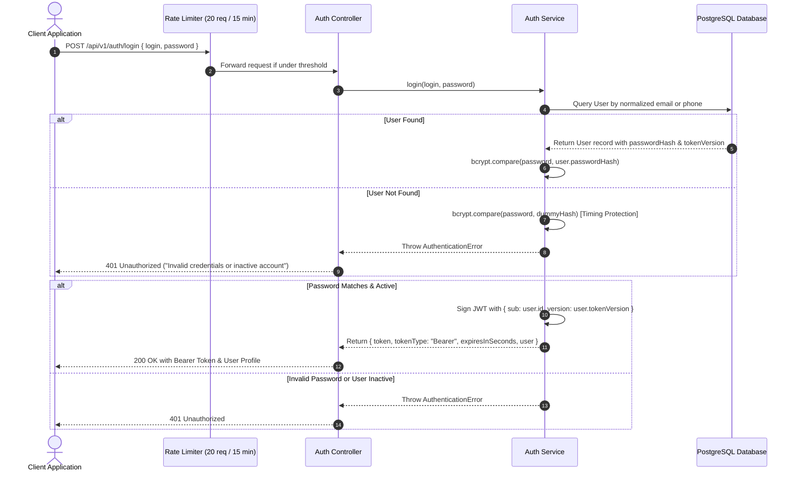
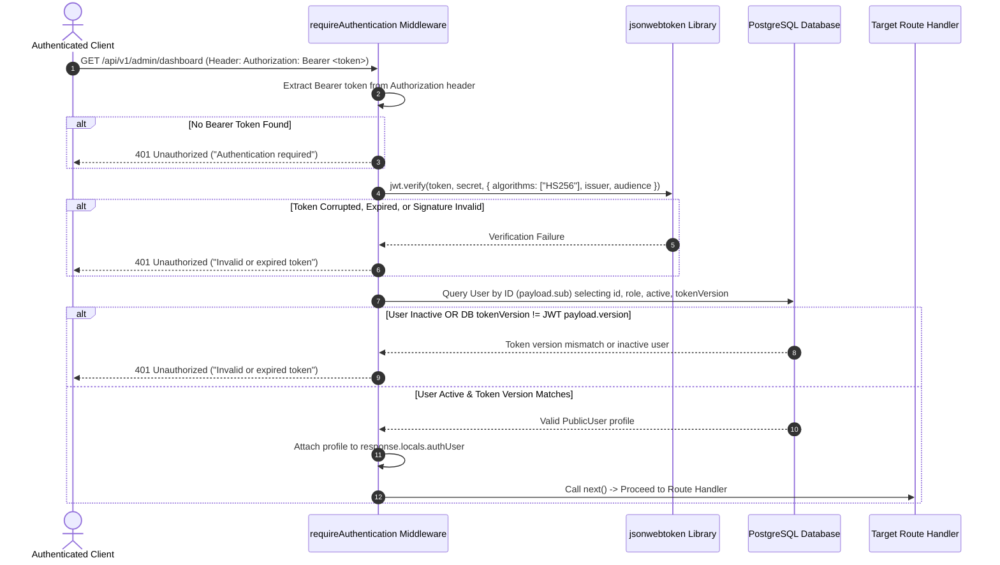

# Authentication and Token Lifecycle Flow

## 1. Overview

The FemmeFlo Inventory system implements a secure, stateless **JWT (JSON Web Token)** authentication system combined with **server-side Token Versioning** to support instantaneous global revocation without requiring stateful Redis session stores.

Key features include:
- Flexible login identifier: Users can authenticate via **email** or **phone number**.
- **Timing attack prevention**: Utilizes constant-time `bcrypt.compare` against dummy hashes when user accounts are not found.
- **Brute-force protection**: Dedicated IP rate limiters on all authentication endpoints (20 attempts per 15-minute sliding window).
- **Session invalidation via `tokenVersion`**: Password updates, deactivations, or resets increment `tokenVersion`, instantly rendering all previously issued tokens invalid.
- **Cryptographic password recovery**: One-time, SHA-256 hashed 32-byte tokens with 20-minute expiration windows.

---

## 2. Authentication Flow Diagram



---

## 3. Request Authorization & Token Verification

Every secured request passes through the `requireAuthentication` middleware:



---

## 4. Token Invalidation Architecture (`tokenVersion`)

### Why Stateless JWTs Typically Fail at Invalidation
Standard JWTs are valid until their expiration timestamp (`exp`). If a user's password is leaked, their privileges revoked, or their account deactivated, attackers can normally continue using valid JWTs until they expire.

### FemmeFlo Solution: The `tokenVersion` Pattern
1. In the database, the `User` model contains an integer column: `tokenVersion Int @default(0)`.
2. When a JWT is minted during login, the payload includes:
   ```json
   {
     "sub": "b2f5c128-4e8c-4a37-b4d2-...",
     "version": 0,
     "iss": "femmeflo-inventory-api",
     "aud": "femmeflo-inventory-frontend",
     "iat": 1712571200,
     "exp": 1712574800
   }
   ```
3. During request authentication, `requireAuthentication` queries the database and verifies:
   ```typescript
   if (!user.active || user.tokenVersion !== payload.version) {
     return null; // Token rejected!
   }
   ```
4. **Trigger Events that Increment `tokenVersion`**:
   - User changes password (`PATCH /api/v1/auth/password`): `tokenVersion` increments by `+1`.
   - User completes password reset (`POST /api/v1/auth/reset-password`): `tokenVersion` increments by `+1`.
   - Administrator deactivates user (`PATCH /api/v1/admin/sellers/:id` or `/api/v1/admin/managers/:id` with `active: false`): `tokenVersion` increments by `+1`.

Result: **100% of outstanding tokens for that user are immediately rejected**, terminating any active sessions worldwide.

---

## 5. Password Recovery Workflow (Forgot / Reset)

```mermaid
sequenceDiagram
    autonumber
    actor Client as User Client
    participant Endpoint as Auth Controller
    participant Service as Auth Service
    participant DB as PostgreSQL Database
    
    Client->>Endpoint: POST /api/v1/auth/forgot-password { login: "seller@femmeflo.com" }
    Endpoint->>Service: forgotPassword(login)
    Service->>DB: Query User by email or phone
    
    alt User Exists & Active
        Service->>Service: Generate 32-byte crypto random string (rawToken)
        Service->>Service: Compute SHA-256 hash (tokenHash)
        Service->>DB: Invalidate existing unused tokens (usedAt = now())
        Service->>DB: Insert PasswordReset record { userId, tokenHash, expiresAt: now() + 20min }
    end
    
    Service-->>Endpoint: Return generic success message (prevents user enumeration)
    Endpoint-->>Client: 200 OK ("If an account exists, a password reset request has been created.")
    
    Note over Client, DB: User receives raw token (or in dev mode via debugToken)
    
    Client->>Endpoint: POST /api/v1/auth/reset-password { token: rawToken, newPassword }
    Endpoint->>Service: resetPassword(rawToken, newPassword)
    Service->>Service: Compute SHA-256 hash of provided rawToken
    Service->>DB: Find PasswordReset where tokenHash, usedAt is null, expiresAt > now()
    
    alt Valid Token Found
        Service->>Service: Hash newPassword with bcrypt (12 rounds)
        Service->>DB: Transaction: Update User passwordHash & increment tokenVersion; mark token used
        Service-->>Endpoint: Password updated
        Endpoint-->>Client: 200 OK ("Password reset successfully. Please log in.")
    else Token Expired, Used, or Invalid
        Service-->>Endpoint: Throw HttpError(400)
        Endpoint-->>Client: 400 Bad Request ("Invalid, expired, or already used password reset token")
    end
```

---

## 6. Security Controls Summary

| Security Feature | Implementation Details | Source Reference |
| --- | --- | --- |
| **Password Hashing** | Bcrypt with 12 salt rounds; max password length 72 UTF-8 bytes to avoid bcrypt truncation attacks | [auth.service.ts](file:///c:/Users/Hitesh/Desktop/Inventory-Project/femmeflo-yfa-inventory-server/src/services/auth/auth.service.ts) |
| **Timing Attack Mitigation** | When a queried user is absent, `bcrypt.compare` executes against a random pre-computed dummy hash | [auth.service.ts:L12](file:///c:/Users/Hitesh/Desktop/Inventory-Project/femmeflo-yfa-inventory-server/src/services/auth/auth.service.ts#L12) |
| **Rate Limiting** | `express-rate-limit`: 20 requests per 15-minute window for `/login`, `/forgot-password`, `/reset-password` | [auth.routes.ts:L11-L14](file:///c:/Users/Hitesh/Desktop/Inventory-Project/femmeflo-yfa-inventory-server/src/routes/auth/auth.routes.ts#L11-L14) |
| **Cache Headers** | Explicit `Cache-Control: no-store` header applied to prevent token caching in proxy or browser caches | [auth.routes.ts:L9](file:///c:/Users/Hitesh/Desktop/Inventory-Project/femmeflo-yfa-inventory-server/src/routes/auth/auth.routes.ts#L9) |
| **Token Invalidation** | `tokenVersion` increments on password modification or account status change | [auth.service.ts:L63](file:///c:/Users/Hitesh/Desktop/Inventory-Project/femmeflo-yfa-inventory-server/src/services/auth/auth.service.ts#L63) |
| **Audit Logs** | URL parameters and queries are omitted from Morgan access logs to avoid leaking reset tokens | [app.ts:L23-L25](file:///c:/Users/Hitesh/Desktop/Inventory-Project/femmeflo-yfa-inventory-server/src/app.ts#L23-L25) |
