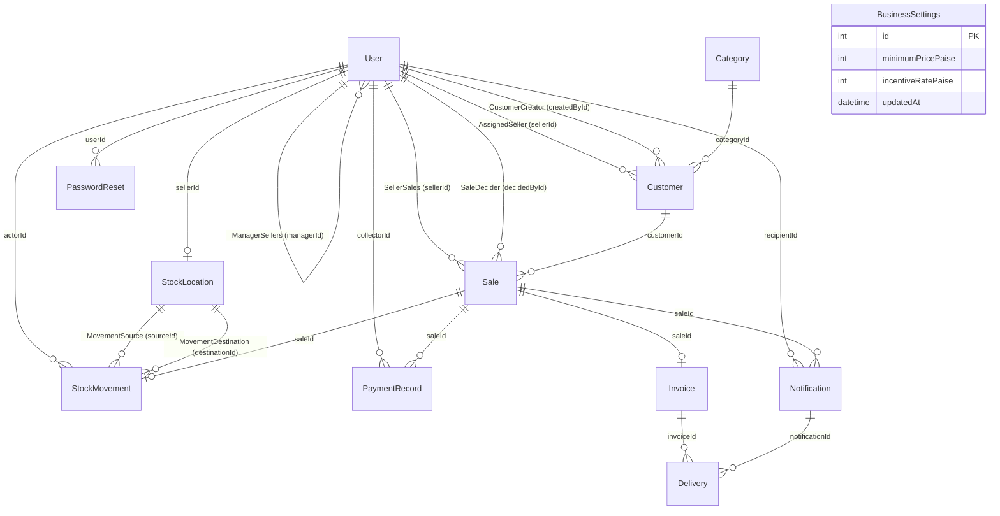

# Database Architecture and Schema Design

## 1. Overview & Principles

The database layer runs on **PostgreSQL 15+** managed via **Prisma ORM 7**. The schema is optimized for consistency, relational integrity, financial accuracy, and strict multi-territory isolation.

### Core Architectural Principles:
1. **Integer Paise for All Currency Values**: To avoid IEEE 754 floating-point inaccuracies, all monetary figures (`unitPricePaise`, `totalPaise`, `incentiveRatePaise`, `incentiveAmountPaise`, `minimumPricePaise`, `amountPaise`) are stored as **integers representing Paise** (1 Rupee = 100 Paise).
2. **UUID Primary Keys**: All entities use UUID v4 strings for globally unique, distributed-safe identification, preventing sequential enumeration attacks.
3. **Double-Entry Ledger Pattern for Stock**: Stock movements (`RECEIPT`, `TRANSFER`, `SALE`) are recorded in an append-only `StockMovement` table linking `sourceId` and `destinationId` locations.
4. **Geographic Scoping**: Hierarchical territorial fields (`state`, `district`, `village`) are indexed across Users and Customers.
5. **Instant Session Invalidation**: The `User` model holds `tokenVersion: Int` to instantly revoke issued JWTs upon credential or status modifications.

---

## 2. Entity-Relationship (ER) Diagram

---

## 3. Enumerations

| Enum Name | Values | Business Purpose |
| --- | --- | --- |
| `Role` | `SUPER_ADMIN`, `MANAGER`, `SELLER` | System user access level. |
| `StockLocationType` | `HQ`, `WAREHOUSE`, `SELLER` | Categorizes physical or virtual inventory points. |
| `StockMovementType` | `RECEIPT`, `TRANSFER`, `SALE` | Denotes inventory inflow, internal transfer, or customer sale deduction. |
| `PaymentMode` | `CASH`, `BANK`, `PENDING` | Payment status/instrument recorded at the point of sale. |
| `SaleStatus` | `PENDING_APPROVAL`, `CONFIRMED`, `REJECTED` | Lifecycle stage of a sale order. |
| `DeliveryChannel` | `EMAIL`, `WHATSAPP` | Dispatch channel for invoice and system notifications. |
| `DeliveryStatus` | `PENDING`, `SENT`, `FAILED` | Background delivery queue state. |

---

## 4. Models and Table Definitions

### 4.1 `User`
Stores system accounts across all three active roles.

| Column | Type | Constraints / Attributes | Description |
| --- | --- | --- | --- |
| `id` | `UUID` | `@id @default(uuid())` | Primary key |
| `name` | `String` | Non-null | Full name |
| `email` | `String?` | `@unique` | Optional unique email address (lowercased) |
| `phone` | `String?` | `@unique` | Optional unique phone number (normalized) |
| `passwordHash` | `String` | Non-null | Bcrypt hash (12 rounds) |
| `role` | `Role` | Non-null | User role (`SUPER_ADMIN`, `MANAGER`, `SELLER`) |
| `active` | `Boolean` | `@default(true)` | Active status flag; disabled users cannot authenticate |
| `tokenVersion` | `Int` | `@default(0)` | Incrementing counter; invalidates all issued JWTs |
| `managerId` | `UUID?` | Foreign key to `User(id)` | Parent Manager ID for Sellers |
| `state` | `String?` | Nullable | Assigned state territory |
| `district` | `String?` | Nullable | Assigned district territory |
| `village` | `String?` | Nullable | Assigned village territory |
| `permissions` | `String[]` | `@default([])` | Granular permission list assigned by Super Admin |
| `createdAt` | `DateTime` | `@default(now())` | Creation timestamp |
| `updatedAt` | `DateTime` | `@updatedAt` | Last modification timestamp |

**Indexes**:
- `@@index([managerId])`
- `@@index([role, active])`

---

### 4.2 `Category`
Product categories under which customer shops are classified.

| Column | Type | Constraints | Description |
| --- | --- | --- | --- |
| `id` | `UUID` | `@id @default(uuid())` | Primary key |
| `name` | `String` | `@unique` | Distinct category name (e.g., General Store, Pharmacy) |
| `active` | `Boolean` | `@default(true)` | Category availability flag |
| `createdAt` | `DateTime` | `@default(now())` | Record creation timestamp |
| `updatedAt` | `DateTime` | `@updatedAt` | Record update timestamp |

---

### 4.3 `Customer`
Commercial retail customer, shop, or distributor onboarded by a Seller or Manager.

| Column | Type | Constraints | Description |
| --- | --- | --- | --- |
| `id` | `UUID` | `@id @default(uuid())` | Primary key |
| `shopName` | `String` | Non-null | Name of the retail shop |
| `contactName` | `String` | Non-null | Primary contact person |
| `phone` | `String` | Non-null | Primary contact phone number |
| `email` | `String?` | Nullable | Optional contact email |
| `categoryId` | `UUID` | FK `Category(id)` | Retail shop classification |
| `sellerId` | `UUID` | FK `User(id)` | Assigned field Seller responsible for account |
| `createdById` | `UUID` | FK `User(id)` | User who performed onboarding (Manager or Seller) |
| `state` | `String` | Non-null | State where shop is located |
| `district` | `String` | Non-null | District where shop is located |
| `village` | `String` | Non-null | Village / locality where shop is located |
| `photoPath` | `String?` | Nullable | File path / URL for shop storefront picture |
| `latitude` | `Decimal(9, 6)?` | Nullable | Precise GPS latitude coordinate |
| `longitude` | `Decimal(9, 6)?` | Nullable | Precise GPS longitude coordinate |
| `active` | `Boolean` | `@default(true)` | Operational flag |
| `createdAt` | `DateTime` | `@default(now())` | Onboarding timestamp |
| `updatedAt` | `DateTime` | `@updatedAt` | Modification timestamp |

**Indexes**:
- `@@index([sellerId])`
- `@@index([state, district, village])`
- `@@index([categoryId])`

---

### 4.4 `StockLocation`
Physical or logical holding location for product packets.

| Column | Type | Constraints | Description |
| --- | --- | --- | --- |
| `id` | `UUID` | `@id @default(uuid())` | Primary key |
| `type` | `StockLocationType` | Non-null | `HQ`, `WAREHOUSE`, or `SELLER` |
| `name` | `String` | Non-null | Human-readable location identifier |
| `sellerId` | `UUID?` | `@unique`, FK `User(id)` | Linked Seller ID (1:1 relation for seller locations) |
| `balance` | `Int` | `@default(0)` | Real-time current packet balance |
| `createdAt` | `DateTime` | `@default(now())` | Creation timestamp |
| `updatedAt` | `DateTime` | `@updatedAt` | Modification timestamp |

**Indexes**:
- `@@index([type])`

---

### 4.5 `StockMovement`
Immutable audit log recording every inventory flow.

| Column | Type | Constraints | Description |
| --- | --- | --- | --- |
| `id` | `UUID` | `@id @default(uuid())` | Primary key |
| `type` | `StockMovementType` | Non-null | `RECEIPT` (into HQ), `TRANSFER`, or `SALE` |
| `quantity` | `Int` | Non-null | Number of packets moved (positive integer) |
| `sourceId` | `UUID?` | FK `StockLocation(id)` | Origin location (null for HQ receipts) |
| `destinationId` | `UUID?` | FK `StockLocation(id)` | Destination location (null for customer sales) |
| `actorId` | `UUID` | FK `User(id)` | User who executed the action |
| `saleId` | `UUID?` | `@unique`, FK `Sale(id)` | Linked sale order (for SALE type movements) |
| `requestKey` | `String?` | `@unique` | Idempotency key preventing duplicate transfers |
| `createdAt` | `DateTime` | `@default(now())` | Movement timestamp |

**Indexes**:
- `@@index([sourceId, createdAt])`
- `@@index([destinationId, createdAt])`

---

### 4.6 `BusinessSettings`
Singleton table (enforced with `id = 1`) maintaining global business parameters.

| Column | Type | Constraints | Description |
| --- | --- | --- | --- |
| `id` | `Int` | `@id @default(1)` | Singleton identifier |
| `minimumPricePaise` | `Int` | `@default(2500)` | Threshold below which sales require Super Admin approval (Default ₹25.00) |
| `incentiveRatePaise` | `Int?` | Nullable | Commission rate per confirmed packet in Paise (e.g., 200 = ₹2.00/packet) |
| `updatedAt` | `DateTime` | `@updatedAt` | Timestamp of last parameter adjustment |

---

### 4.7 `Sale`
Records packet sales submitted by field Sellers.

| Column | Type | Constraints | Description |
| --- | --- | --- | --- |
| `id` | `UUID` | `@id @default(uuid())` | Primary key |
| `sellerId` | `UUID` | FK `User(id)` | Seller who executed the transaction |
| `customerId` | `UUID` | FK `Customer(id)` | Customer purchasing the packets |
| `quantity` | `Int` | Non-null | Total packets sold |
| `unitPricePaise` | `Int` | Non-null | Unit price charged in Paise |
| `totalPaise` | `Int` | Non-null | Calculated total (`quantity * unitPricePaise`) |
| `paymentMode` | `PaymentMode` | Non-null | `CASH`, `BANK`, or `PENDING` |
| `status` | `SaleStatus` | Non-null | `PENDING_APPROVAL`, `CONFIRMED`, `REJECTED` |
| `requestedAt` | `DateTime` | `@default(now())` | Order submission time |
| `confirmedAt` | `DateTime?` | Nullable | Order confirmation timestamp |
| `decidedAt` | `DateTime?` | Nullable | Timestamp when Super Admin approved or rejected order |
| `decidedById` | `UUID?` | FK `User(id)` | Super Admin who approved/rejected the order |
| `rejectionReason` | `String?` | Nullable | Recorded explanation if rejected |
| `incentiveRatePaise` | `Int?` | Nullable | Snapshot of the active incentive rate at time of confirmation |
| `incentiveAmountPaise` | `Int?` | Nullable | Snapshot of total incentive earned (`quantity * incentiveRatePaise`) |
| `requestKey` | `String?` | `@unique` | Idempotency key from client app |
| `createdAt` | `DateTime` | `@default(now())` | Creation timestamp |
| `updatedAt` | `DateTime` | `@updatedAt` | Modification timestamp |

**Indexes**:
- `@@index([sellerId, createdAt])`
- `@@index([status, createdAt])`
- `@@index([customerId])`

---

### 4.8 `PaymentRecord`
Audit trail of financial collections linked to confirmed sales.

| Column | Type | Constraints | Description |
| --- | --- | --- | --- |
| `id` | `UUID` | `@id @default(uuid())` | Primary key |
| `saleId` | `UUID` | FK `Sale(id)` | Target sale order |
| `collectorId` | `UUID` | FK `User(id)` | User who received payment (typically the field Seller) |
| `mode` | `PaymentMode` | Non-null | Payment channel (`CASH` or `BANK`) |
| `amountPaise` | `Int` | Non-null | Amount collected in Paise |
| `createdAt` | `DateTime` | `@default(now())` | Timestamp of collection |

**Indexes**:
- `@@index([saleId])`

---

### 4.9 `Invoice`
Immutable legal billing record generated for every confirmed sale.

| Column | Type | Constraints | Description |
| --- | --- | --- | --- |
| `id` | `UUID` | `@id @default(uuid())` | Primary key |
| `saleId` | `UUID` | `@unique`, FK `Sale(id)` | 1:1 relation to confirmed Sale |
| `number` | `String` | `@unique` | Human-readable sequential reference (`INV-{timestamp}-{rand}`) |
| `snapshot` | `Json` | Non-null | Complete point-in-time JSON snapshot (customer, seller, pricing) |
| `pdfPath` | `String?` | Nullable | Local disk file path (`/storage/invoices/YYYY/MM/*.pdf`) |
| `createdAt` | `DateTime` | `@default(now())` | Invoice creation timestamp |

---

### 4.10 `Notification`
System-generated alerts triggered by key operational events.

| Column | Type | Constraints | Description |
| --- | --- | --- | --- |
| `id` | `UUID` | `@id @default(uuid())` | Primary key |
| `recipientId` | `UUID` | FK `User(id)` | Target recipient |
| `saleId` | `UUID?` | FK `Sale(id)` | Associated sale if applicable |
| `kind` | `String` | Non-null | Notification type (`LOW_PRICE_APPROVAL_REQUEST`, `LOW_PRICE_SALE_APPROVED`, etc.) |
| `message` | `String` | Non-null | Plaintext alert description |
| `readAt` | `DateTime?` | Nullable | Timestamp when recipient viewed notification |
| `createdAt` | `DateTime` | `@default(now())` | Dispatch timestamp |

**Indexes**:
- `@@index([recipientId, createdAt])`

---

### 4.11 `Delivery`
External dispatch tracking for invoices and notifications across third-party communication channels (Email, WhatsApp).

| Column | Type | Constraints | Description |
| --- | --- | --- | --- |
| `id` | `UUID` | `@id @default(uuid())` | Primary key |
| `invoiceId` | `UUID?` | FK `Invoice(id)` | Linked invoice |
| `notificationId` | `UUID?` | FK `Notification(id)` | Linked notification |
| `channel` | `DeliveryChannel` | Non-null | `EMAIL` or `WHATSAPP` |
| `status` | `DeliveryStatus` | `@default(PENDING)` | `PENDING`, `SENT`, or `FAILED` |
| `attempts` | `Int` | `@default(0)` | Retry attempt counter |
| `nextAttemptAt` | `DateTime?` | Nullable | Retry schedule backoff timestamp |
| `providerRef` | `String?` | Nullable | Remote vendor transaction/message ID |
| `lastError` | `String?` | Nullable | Last recorded failure error trace |
| `createdAt` | `DateTime` | `@default(now())` | Record creation timestamp |
| `updatedAt` | `DateTime` | `@updatedAt` | Record update timestamp |

**Indexes**:
- `@@index([status, nextAttemptAt])`

---

### 4.12 `PasswordReset`
Cryptographically secure tokens for password recovery workflows.

| Column | Type | Constraints | Description |
| --- | --- | --- | --- |
| `id` | `UUID` | `@id @default(uuid())` | Primary key |
| `userId` | `UUID` | FK `User(id)` | Account requesting recovery |
| `tokenHash` | `String` | `@unique` | SHA-256 hash of random 32-byte hex token |
| `expiresAt` | `DateTime` | Non-null | Expiration time (20 minutes from creation) |
| `usedAt` | `DateTime?` | Nullable | Timestamp when token was consumed |
| `createdAt` | `DateTime` | `@default(now())` | Request timestamp |

**Indexes**:
- `@@index([userId, expiresAt])`
