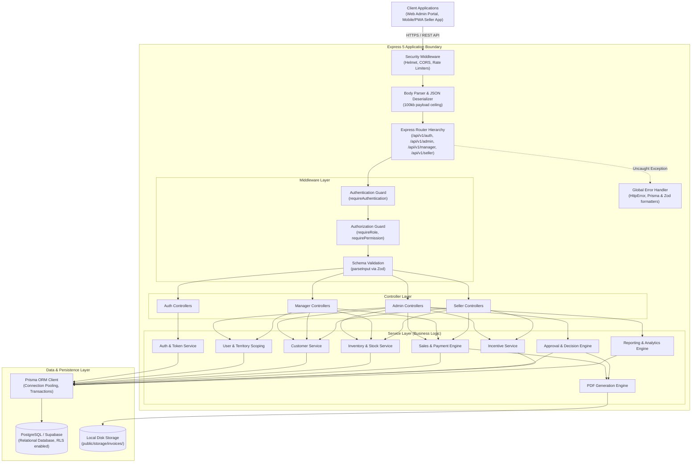

# System Architecture Overview

## 1. Executive Summary

The **FemmeFlo YFA Inventory Management System** is an enterprise-grade, role-based distribution, inventory, and sales platform designed for centralized supply chain operations. The system bridges physical warehouse inventory with field sales teams, providing end-to-end operational visibility:

```text
HQ Stock → Regional Warehouse → Field Seller → Shop / Customer → Sale → Payment Collection → Automated Inventory Deduction → Incentive Calculation → Invoice Generation (PDF) → Executive Reports
```

The application is built on a clean three-tier architecture with strict Role-Based Access Control (RBAC), multi-level geographic data scoping, and atomic database transactions.

---

## 2. Technology Stack

| Layer | Technologies | Purpose |
| --- | --- | --- |
| **Runtime Environment** | Node.js (v22.12+ / v24+) | Modern ES Module runtime executing asynchronous I/O operations |
| **Language** | TypeScript (ES2022 / NodeNext) | Static typing, interface contracts, and compile-time safety |
| **Web Framework** | Express 5 | High-performance HTTP application routing, middleware execution, and error handling |
| **Database & ORM** | PostgreSQL 15+ / Supabase & Prisma ORM 7 | Relational persistence, migrations, type-safe query building, and transactional integrity |
| **Security & Cryptography** | `bcrypt` (12 salt rounds), `jsonwebtoken`, `crypto` | Password hashing, JWT signing/verification, and secure random token generation |
| **Validation** | Zod (v4 pre-release) | Strict request payload, query parameter, and environment configuration validation |
| **Document Processing** | PDFKit | Server-side invoice generation with filesystem persistence |
| **Data Export** | ExcelJS | Multi-sheet spreadsheet (XLSX) and CSV reporting exports |
| **API Documentation** | Swagger UI Express & Swagger JSDoc | Interactive OpenAPI 3.0 visualization mounted at `/docs` |
| **HTTP Security** | Helmet, CORS, Express Rate Limit | Security header injection, origin protection, and brute-force prevention |

---

## 3. Tiered System Architecture



---

## 4. Key Architectural Patterns

### 4.1 Strict Multi-Tenancy Scoping by Geography and Role
The system enforces data isolation at the service level rather than purely relying on database row-level security:
1. **Super Admin**: Global scope across all territories, managers, sellers, and stock locations.
2. **Manager**: Scoped by geographic boundary (`state`, `district`, `village`) and direct relational hierarchy (`managerId`). Managers can only access and onboard sellers assigned to their hierarchy and operating strictly within their territory.
3. **Seller**: Scoped strictly to their own entity (`sellerId = authUser.id`). Sellers can only view their own inventory balance, customers, sales history, and incentives.

### 4.2 Atomic Transactional Integrity
All state-modifying operations involving inventory, financial figures, or multi-table updates are executed within **Prisma interactive transactions** (`database.$transaction(async (tx) => { ... })`). This guarantees:
- Stock balances never drop below zero.
- Low-price sales never deduct stock until formally approved.
- Confirmed sales simultaneously decrement stock, generate a `StockMovement` ledger entry, create an `Invoice` record, and log initial payments.

### 4.3 Stateless Authentication with Token Version Invalidation
Authentication relies on stateless JWTs, but invalidation is instantaneous:
- The `User` table maintains an integer `tokenVersion`.
- Each issued JWT embeds `{ version: user.tokenVersion }`.
- When a user changes their password, is deactivated by an administrator, or completes a password reset, `tokenVersion` increments (`+1`).
- The `requireAuthentication` middleware validates the token signature AND verifies that `payload.version === user.tokenVersion` against the live database record.

### 4.4 Idempotent Background PDF Generation
Invoice PDFs are generated and written to disk (`public/storage/invoices/YYYY/MM/INV-xxx.pdf`) asynchronously following transaction completion. An idempotency check (`if (invoice.pdfPath) return invoice.pdfPath;`) ensures PDFs are never regenerated unnecessarily.

---

## 5. Architectural Directory Layout

- **Architecture Documentation**: [Overview](file:///c:/Users/Hitesh/Desktop/Inventory-Project/femmeflo-yfa-inventory-server/docs/architecture/overview.md) | [Folder Structure](file:///c:/Users/Hitesh/Desktop/Inventory-Project/femmeflo-yfa-inventory-server/docs/architecture/folder-structure.md) | [Database Design](file:///c:/Users/Hitesh/Desktop/Inventory-Project/femmeflo-yfa-inventory-server/docs/architecture/database.md) | [Authentication Flow](file:///c:/Users/Hitesh/Desktop/Inventory-Project/femmeflo-yfa-inventory-server/docs/architecture/authentication-flow.md)
- **Role Specifications**: [Super Admin](file:///c:/Users/Hitesh/Desktop/Inventory-Project/femmeflo-yfa-inventory-server/docs/roles/super-admin/README.md) | [Manager](file:///c:/Users/Hitesh/Desktop/Inventory-Project/femmeflo-yfa-inventory-server/docs/roles/manager/README.md) | [Seller](file:///c:/Users/Hitesh/Desktop/Inventory-Project/femmeflo-yfa-inventory-server/docs/roles/seller/README.md)
- **Shared Functionality**: [Shared Features](file:///c:/Users/Hitesh/Desktop/Inventory-Project/femmeflo-yfa-inventory-server/docs/shared/common-features.md)
- **API Reference**: [API Catalog](file:///c:/Users/Hitesh/Desktop/Inventory-Project/femmeflo-yfa-inventory-server/docs/api/endpoints.md)
