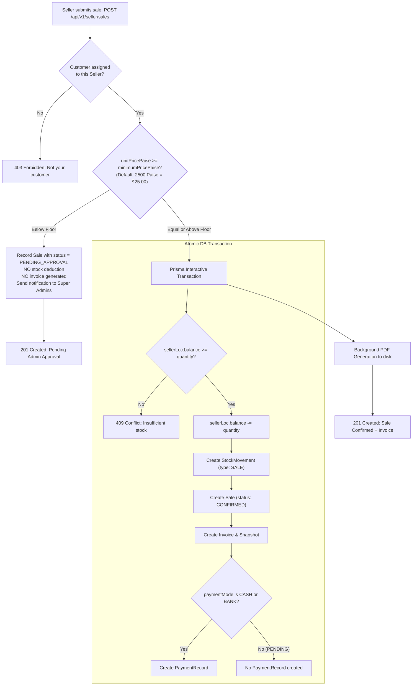

# Seller: Sales Operations & Payment Collection Module

## 1. Module Purpose

Represents the core transactional engine for field sales. Allows Sellers to record sales orders delivered to assigned retail shops, manage payment instruments (`CASH`, `BANK`, `PENDING`), collect outstanding balances, and handle automatic approval routing for discounted unit prices.

---

## 2. Business Logic & Transactional Execution



### Payment Collection for `PENDING` Sales:
- If an order was originally recorded with `paymentMode: "PENDING"`, the seller collects cash or bank transfer later and calls:
  `PATCH /api/v1/seller/sales/:id/payment` with `{ "mode": "CASH" | "BANK" }`.
- Executes inside a transaction:
  1. Verifies order belongs to this seller.
  2. Verifies current status is `PENDING` (throws `409 Conflict` if already collected).
  3. Updates `Sale.paymentMode` to `CASH` or `BANK`.
  4. Inserts `PaymentRecord` with `collectorId = seller.id` and `amountPaise = sale.totalPaise`.

---

## 3. Endpoints

| Method | Path | Summary | Auth & Guard |
| --- | --- | --- | --- |
| `POST` | `/api/v1/seller/sales` | Submit a sales order | `requireRole("SELLER")` |
| `GET` | `/api/v1/seller/sales` | List own sales with filters (period, status, payment) | `requireRole("SELLER")` |
| `GET` | `/api/v1/seller/sales/:id` | View detailed sale record & invoice | `requireRole("SELLER")` |
| `PATCH` | `/api/v1/seller/sales/:id/payment` | Collect outstanding payment on `PENDING` sale | `requireRole("SELLER")` |

---

## 4. Request & Response Examples

### 4.1 Create Standard Sale (Price >= ₹25.00)
```http
POST /api/v1/seller/sales
Authorization: Bearer <token>
Content-Type: application/json

{
  "customerId": "e2c3b4d5-6a7b-8c9d-0e1f-2a3b4c5d6e7f",
  "quantity": 50,
  "unitPricePaise": 2500,
  "paymentMode": "CASH"
}
```

#### Response (201 Created)
```json
{
  "success": true,
  "message": "Sale confirmed successfully",
  "data": {
    "sale": {
      "id": "a1b2c3d4-e5f6-7a8b-9c0d-1e2f3a4b5c6d",
      "quantity": 50,
      "unitPricePaise": 2500,
      "totalPaise": 125000,
      "paymentMode": "CASH",
      "status": "CONFIRMED",
      "confirmedAt": "2026-04-01T16:30:00.000Z",
      "incentiveRatePaise": 200,
      "incentiveAmountPaise": 10000,
      "customer": {
        "id": "e2c3b4d5-6a7b-8c9d-0e1f-2a3b4c5d6e7f",
        "shopName": "Mahalaxmi Provision Store"
      },
      "invoice": {
        "id": "c9d8e7f6-a5b4-3c2d-1e0f-9a8b7c6d5e4f",
        "number": "INV-1712574600000-312",
        "pdfPath": "/storage/invoices/2026/04/INV-1712574600000-312.pdf"
      }
    }
  }
}
```

### 4.2 Collect Payment on `PENDING` Sale
```http
PATCH /api/v1/seller/sales/a1b2c3d4-e5f6-7a8b-9c0d-1e2f3a4b5c6d/payment
Authorization: Bearer <token>
Content-Type: application/json

{
  "mode": "CASH"
}
```

#### Response (200 OK)
```json
{
  "success": true,
  "message": "Pending payment collected successfully",
  "data": {
    "sale": {
      "id": "a1b2c3d4-e5f6-7a8b-9c0d-1e2f3a4b5c6d",
      "paymentMode": "CASH"
    },
    "payment": {
      "id": "5f6e7d8c-9b0a-1b2c-3d4e-5f6a7b8c9d0e",
      "mode": "CASH",
      "amountPaise": 125000,
      "collectorId": "c1f7b889-13da-4a11-8fcb-2e92c2cb9842"
    }
  }
}
```

---

## 5. Source File Links

- **Route Definitions**: [seller/sales.routes.ts](file:///c:/Users/Hitesh/Desktop/Inventory-Project/femmeflo-yfa-inventory-server/src/routes/seller/sales.routes.ts)
- **Controller**: [seller/sales.controller.ts](file:///c:/Users/Hitesh/Desktop/Inventory-Project/femmeflo-yfa-inventory-server/src/controller/seller/sales.controller.ts)
- **Validation**: [sales.validation.ts](file:///c:/Users/Hitesh/Desktop/Inventory-Project/femmeflo-yfa-inventory-server/src/controller/sales.validation.ts) and [payment.validation.ts](file:///c:/Users/Hitesh/Desktop/Inventory-Project/femmeflo-yfa-inventory-server/src/controller/payment.validation.ts)
- **Service**: [seller/sales.service.ts](file:///c:/Users/Hitesh/Desktop/Inventory-Project/femmeflo-yfa-inventory-server/src/services/seller/sales.service.ts)
- **PDF Processing**: [pdf.service.ts](file:///c:/Users/Hitesh/Desktop/Inventory-Project/femmeflo-yfa-inventory-server/src/services/pdf.service.ts)
