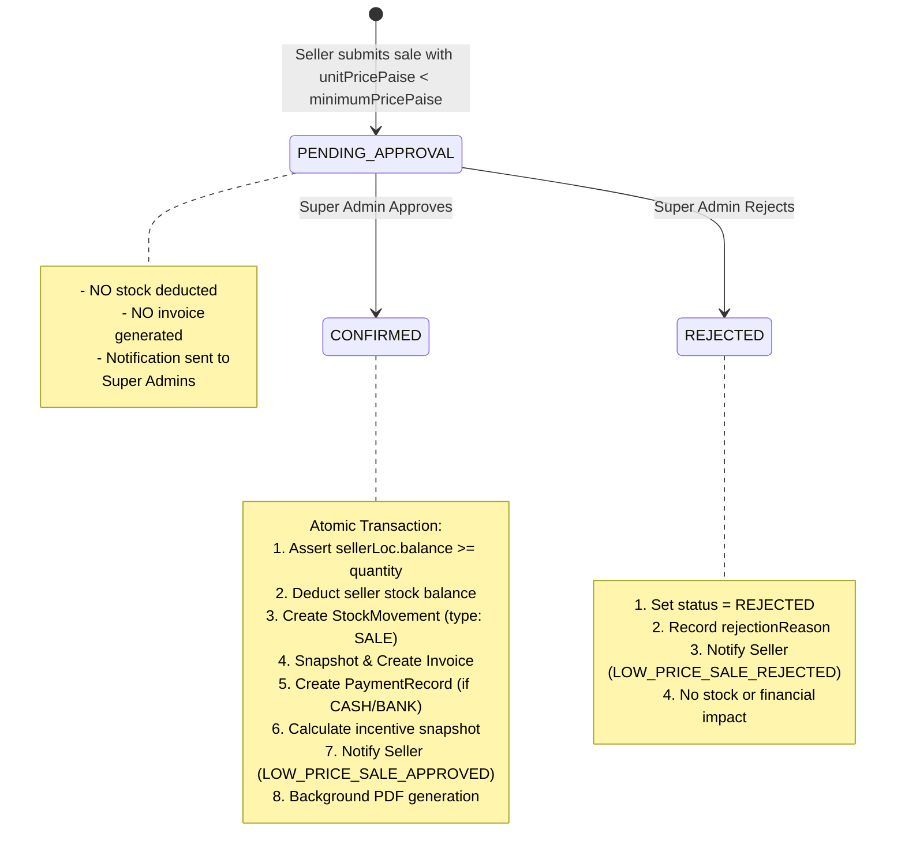

# Super Admin: Low-Price Sale Approval Module

## 1. Module Purpose

Manages the approval lifecycle for sales submitted below the company minimum price floor (`minimumPricePaise`, default 2500 Paise / ₹25.00). Prevents unauthorized discounting while enabling controlled exceptions reviewed directly by the Super Admin.

---

## 2. Business Logic & State Machine



---

## 3. Endpoints

| Method | Path | Summary | Auth & Guard |
| --- | --- | --- | --- |
| `GET` | `/api/v1/admin/approvals` | List all orders with `status = "PENDING_APPROVAL"` | `requireRole("SUPER_ADMIN")` |
| `POST` | `/api/v1/admin/approvals/:saleId/approve` | Approve and confirm low-price sale | `requireRole("SUPER_ADMIN")` |
| `POST` | `/api/v1/admin/approvals/:saleId/reject` | Reject sale with recorded reason | `requireRole("SUPER_ADMIN")` |

---

## 4. Request & Response Examples

### 4.1 Approve Low-Price Sale
```http
POST /api/v1/admin/approvals/e932b14e-6e82-4f79-994c-8f6a9c37617b/approve
Authorization: Bearer <token>
```

#### Response (200 OK)
```json
{
  "success": true,
  "message": "Sale approved and confirmed successfully",
  "data": {
    "sale": {
      "id": "e932b14e-6e82-4f79-994c-8f6a9c37617b",
      "status": "CONFIRMED",
      "quantity": 100,
      "unitPricePaise": 2200,
      "totalPaise": 220000,
      "confirmedAt": "2026-04-01T16:00:00.000Z",
      "decidedAt": "2026-04-01T16:00:00.000Z",
      "decidedById": "2c62c2f6-ec89-498c-8c0c-e2f4a4bf7f09",
      "incentiveRatePaise": 200,
      "incentiveAmountPaise": 20000,
      "customer": { "id": "...", "shopName": "Sai Krupa General Store" },
      "seller": { "id": "...", "name": "Amit Patil" },
      "invoice": {
        "id": "f512c110-8271-460d-8351-4091a0397701",
        "number": "INV-1712572800000-819",
        "pdfPath": "/storage/invoices/2026/04/INV-1712572800000-819.pdf"
      }
    }
  }
}
```

### 4.2 Reject Low-Price Sale
```http
POST /api/v1/admin/approvals/e932b14e-6e82-4f79-994c-8f6a9c37617b/reject
Authorization: Bearer <token>
Content-Type: application/json

{
  "reason": "Discount exceeds allowable promotional threshold for this region."
}
```

#### Response (200 OK)
```json
{
  "success": true,
  "message": "Sale rejected",
  "data": {
    "sale": {
      "id": "e932b14e-6e82-4f79-994c-8f6a9c37617b",
      "status": "REJECTED",
      "decidedAt": "2026-04-01T16:05:00.000Z",
      "decidedById": "2c62c2f6-ec89-498c-8c0c-e2f4a4bf7f09",
      "rejectionReason": "Discount exceeds allowable promotional threshold for this region."
    }
  }
}
```

---

## 5. Source File Links

- **Route Definitions**: [admin/approval.routes.ts](file:///c:/Users/Hitesh/Desktop/Inventory-Project/femmeflo-yfa-inventory-server/src/routes/admin/approval.routes.ts)
- **Controller**: [admin/approval.controller.ts](file:///c:/Users/Hitesh/Desktop/Inventory-Project/femmeflo-yfa-inventory-server/src/controller/admin/approval.controller.ts)
- **Validation**: [sales.validation.ts](file:///c:/Users/Hitesh/Desktop/Inventory-Project/femmeflo-yfa-inventory-server/src/controller/sales.validation.ts)
- **Service**: [admin/approval.service.ts](file:///c:/Users/Hitesh/Desktop/Inventory-Project/femmeflo-yfa-inventory-server/src/services/admin/approval.service.ts)
- **PDF Generation**: [pdf.service.ts](file:///c:/Users/Hitesh/Desktop/Inventory-Project/femmeflo-yfa-inventory-server/src/services/pdf.service.ts)
