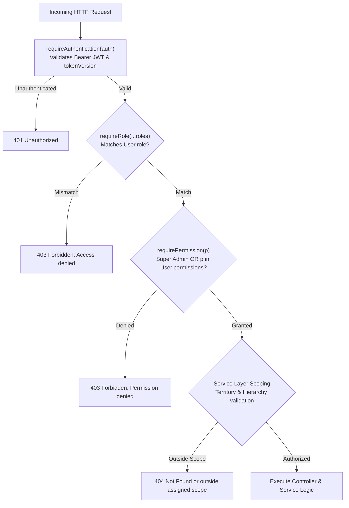

# Shared Platform Feature: Authorization & RBAC

## 1. Overview

The authorization framework combines role-based route guards with fine-grained business permission tokens and multi-level service scoping.

---

## 2. Authorization Layers

---

## 3. Middleware Guards

### 3.1 `requireRole(...roles: Role[])`
Defined in [rbac.middleware.ts:L42](file:///c:/Users/Hitesh/Desktop/Inventory-Project/femmeflo-yfa-inventory-server/src/middleware/rbac.middleware.ts#L42):
- Asserts that `response.locals.authUser.role` is included in the allowed list.
- Rejects unauthorized users with `403 Forbidden ("Access denied")`.

### 3.2 `requirePermission(permission: Permission)`
Defined in [rbac.middleware.ts:L8](file:///c:/Users/Hitesh/Desktop/Inventory-Project/femmeflo-yfa-inventory-server/src/middleware/rbac.middleware.ts#L8):
- If `role === "SUPER_ADMIN"`, automatically bypasses check.
- If `role === "MANAGER"`, verifies `user.permissions.includes(permission)`.
- Otherwise rejects with `403 Forbidden ("Permission denied")`.

### 3.3 `requireAnyPermission(permissions: Permission[])`
Defined in [rbac.middleware.ts:L23](file:///c:/Users/Hitesh/Desktop/Inventory-Project/femmeflo-yfa-inventory-server/src/middleware/rbac.middleware.ts#L23):
- Passes if the Manager holds at least one matching permission from the array.

---

## 4. Territory & Hierarchy Scoping

Even if a user holds a valid role and permission, service-level scoping enforces boundary security:

| Role | Geographic Boundary | Hierarchy Boundary |
| --- | --- | --- |
| **Super Admin** | Unrestricted (all states, districts, villages) | All managers, all sellers |
| **Manager** | Confined to assigned `state`, `district`, `village` | Confined to `seller.managerId = manager.id` |
| **Seller** | Confined to assigned locality | Confined to `sellerId = seller.id` |

---

## 5. Source File Links

- **Middleware**: [rbac.middleware.ts](file:///c:/Users/Hitesh/Desktop/Inventory-Project/femmeflo-yfa-inventory-server/src/middleware/rbac.middleware.ts)
- **Permissions Constants**: [permissions.ts](file:///c:/Users/Hitesh/Desktop/Inventory-Project/femmeflo-yfa-inventory-server/src/constants/permissions.ts)
- **Master Route Guard Setup**: [user.routes.ts](file:///c:/Users/Hitesh/Desktop/Inventory-Project/femmeflo-yfa-inventory-server/src/routes/user.routes.ts)
