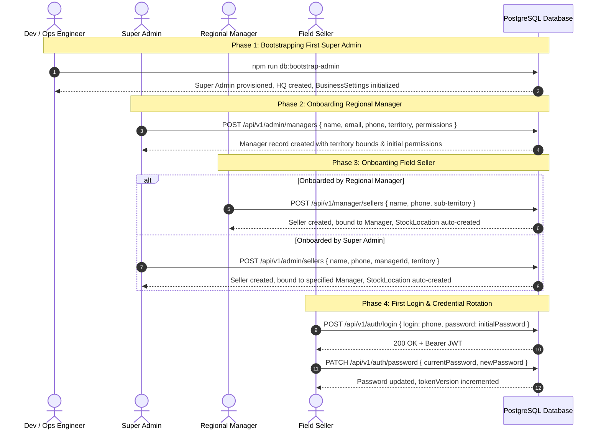

# Workflow: User Lifecycle Management

## 1. Overview

This document details the complete end-to-end user provisioning, territorial assignment, credential lifecycle, and deactivation workflows across all three user roles: Super Admin, Manager, and Seller.

---

## 2. End-to-End User Provisioning Sequence

---

## 3. Account Deactivation & Session Revocation

When personnel leave the organization or an account is compromised:
1. Super Admin calls `PATCH /api/v1/admin/sellers/:id` or `/api/v1/admin/managers/:id` with `{ "active": false }`.
2. The service executes `database.user.update` with `active: false` and increments `tokenVersion: { increment: 1 }`.
3. Any active JWTs for this user immediately fail signature validation during subsequent requests (`user.tokenVersion !== payload.version` or `!user.active`).
4. Future login attempts are rejected with `401 Unauthorized`.
